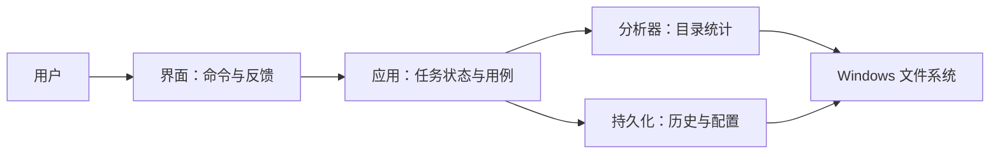
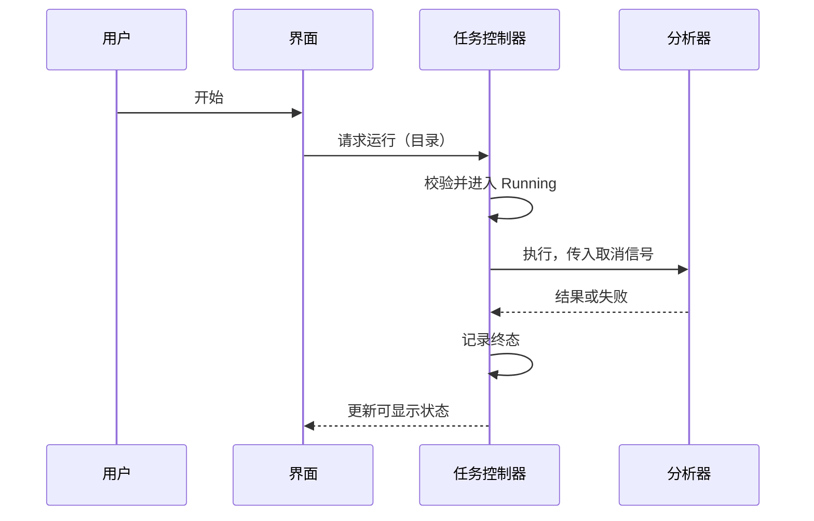

# 01 从一个窗口到一个可交付的客户端

你可能已经会做按钮、列表和设置页。现在接到一个需求：选择目录，统计文件数量与总大小，把结果显示出来。第一次实现可以很短：按钮事件里遍历目录，再给两个标签赋值。

接着需求变了：目录里有十万个文件，用户要能取消；程序重开后能看到历史；客户说某台机器打不开；另一个团队希望不通过界面也能调用分析能力。原来的按钮事件开始同时承担交互、任务、数据和支持职责。

本章先决定这些责任怎样分开。学完后，你应能画出程序与用户、系统、模块之间的关系，并把“能用”写成可检查的条件。

## 把需求变成行为约束

“支持取消”有几种解释：点击后不再显示进度、停止安排新工作、等待当前文件处理完、直接结束进程。这些行为对数据和资源的影响不同。先写下本案例的契约：

| 场景 | 首版选择 | 为什么 |
| --- | --- | --- |
| 分析中再次点击开始 | 拒绝第二次启动 | 先避免两个任务争用同一界面状态 |
| 点击取消 | 请求停止，在安全检查点退出 | 避免强行中断时遗留未完成的数据 |
| 遇到不可读文件 | 本轮失败，展示可定位的错误 | 首版不把不完整统计伪装成完整结果 |
| 目录在扫描中变化 | 统计实际观察到的条目 | 普通目录遍历不是文件系统快照 |
| 窗口关闭 | 请求取消并等待收尾 | 不让后台任务继续访问已关闭的界面 |

这不是唯一正确方案。备份软件可能必须记录跳过项，搜索工具可能容忍部分结果。重要的是让界面、SDK 和日志遵守同一个约定。

## 四个责任，不必立刻拆成四个进程

这是一张教学责任图，不是操作系统的固定分层。一个 EXE 内的几个类也可以落实这些责任。

界面拥有选中目录和当前反馈；应用逻辑拥有任务是否允许运行、何时结束；分析器返回结果，不直接弹窗；持久化组件处理数据格式和失败。这样命令行调用方可以复用分析器，测试也不必启动窗口。

再看一次点击的执行顺序：

这张图省略了线程切换；第 04、06 章再补充。逻辑责任和执行位置是两个问题。把分析器移到新线程，不会自动解决任务重复启动。

## 先做小，再决定隔离

首版选择单进程：调试简单，传递对象直接，也没有 IPC 协议。但进程内原生库若破坏内存，可能影响整个应用。第 12 章再引入工作进程，对比隔离收益和协议成本。

同样，不必一开始就做通用插件平台、远程调度和复杂依赖注入。只有出现第二种分析器、第三方模块或明确的故障边界，才增加对应机制。高级设计需要解释增加复杂度的理由，也需要解释暂时不增加什么。

## 动手：给需求做一次变更

在纸上或文档里列出窗口、任务控制器、分析器、历史存储四个组件。为“后台分析十万文件，允许取消”标记谁接收输入、谁保存状态、谁结束任务。再加入“分析能力交给其他团队调用”，检查是否必须重写分析器。

本书的[实验目录](../../examples/README.md)提供独立的小实验；它不是已经包含所有功能的成品工作台。先画出边界，再用后续实验验证局部机制。

验收材料是一页责任图、一条执行时序和上面的行为约束表。不要以类的数量判断设计好坏。

## 检查理解

**为什么不能让分析器在失败时直接弹窗？** 因为命令行、测试和其他应用也可能调用它。弹窗把失败表达绑定到特定交互环境。分析器应返回错误或抛出契约规定的异常，界面再决定怎样表达。

**把每个模块都放到独立进程，会更高级吗？** 未必。它带来序列化、取消、重连、版本和部署成本。只有故障隔离、权限或独立生命周期值得这些成本时，进程边界才有必要。

本章留下的是责任与行为契约。下一章让同一份源码在明确的环境中变成可运行产物。

参考：[Windows 应用开发](https://learn.microsoft.com/en-us/windows/apps/)。

[返回目录](../index.md) · [下一章：可重复的运行](02-build-and-run.md)
