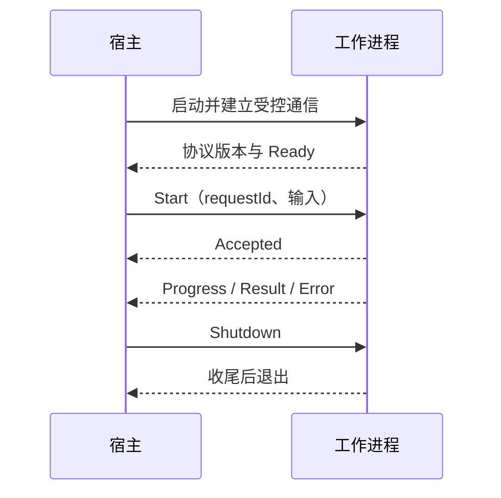

# 12 插件放在进程内，还是隔离到进程外

工作台开始接入第三方分析器。一个模块越界写内存，整个客户端退出。异常捕获未必能把已破坏的进程恢复到可靠状态。现在需要重新选择故障边界。

## 两个方案的代价

进程内插件可以直接调用函数，传递内存和结果，开销与接入复杂度较低。但模块共享地址空间，错误内存写入、锁死和不受控线程可能影响宿主。

工作进程把分析器放在另一个地址空间。宿主通过协议发请求、收状态；工作进程退出后，宿主可以报告失败并启动新实例。但重启并不会自动恢复旧任务，协议与数据需要支持恢复或明确放弃。

| 选择 | 获得什么 | 新增什么责任 |
| --- | --- | --- |
| 进程内 DLL | 直接调用、共享对象、较少序列化 | 生命周期、线程、内存与宿主共同承担 |
| 独立工作进程 | 更明确的崩溃与资源边界 | IPC、监督、取消、版本、部署和退出 |

隔离进程不等于安全沙箱。若两者拥有相同用户权限，工作进程仍可能读写用户可访问的数据。权限限制要另行设计。

## 生命周期比启动命令更重要

工作进程的一条完整路径应是：

启动成功不等于 Ready；Ready 不等于任务已接受；任务接受也不等于执行完成。每个阶段有自己的超时与错误。记录 PID 时同时关联一次启动身份，避免 PID 重用后认错进程。

取消可以发协议消息并等待任务终态。超时后若决定结束工作进程，需要把本轮标为失败或中断，处理半成品，并确认退出。不要把“杀掉了进程”记录成分析成功。

Windows Job Object 可以帮助管理一组进程的资源与生命周期，但实际行为取决于作业配置、创建与归属条件。单纯持有一个子进程对象，不保证所有后代都随宿主结束。

## 卸载一个 DLL 为什么不只是调用 FreeLibrary

需要先拒绝新调用，等待正在执行的调用结束，停止库创建的线程，注销回调，释放库内对象，最后再卸载。若库不能保证这些条件，就不要提供“热卸载成功”的承诺；让进程退出完成回收可能更可控。

共享内存可减少大量数据复制，但必须约定布局、长度、版本、同步和失效标志。跨进程传裸指针依然无效；映射的虚拟地址也不必相同。

## COM 是另一种接口组织方式

COM 使用接口、引用计数等机制组织对象，既可能进程内，也可能进程外。线程要遵守相应初始化与 apartment 模型；接口指针跨 apartment 使用通常涉及封送或特定支持，不能把它当成任意线程可共享的普通指针。

引用计数处理对象寿命，不自动解决业务并发、循环引用或异步退出。学习 COM 时先理解对象与线程边界，再进入注册、封送和更复杂组件模型。

## 动手：模拟一次不受控退出

在独立教学工作进程中安排“收到指定请求后退出”，让宿主区分未 Ready、已接受后退出、结果已提交后退出。为每种情况写状态表、用户提示和重试条件。

这是设计练习，本仓库未提供完整插件宿主或跨进程恢复实现。不要把第 10 章的同步 DLL 例子当成隔离框架。

## 检查理解

**为什么不能对所有失败直接重启并重试？** 上一次可能已写出结果，只是响应丢失。没有幂等或状态查询，重试可能产生重复副作用。

**隔离后就不需要管理资源了吗？** 仍需管理通信句柄、临时文件、数据库状态和宿主侧任务。进程退出只回收一部分运行资源，不能替你修复外部状态。

下一阶段把这些边界与文件、数据库和系统权限连起来。

参考：[进程与 apartment](https://learn.microsoft.com/en-us/windows/win32/com/processes--threads--and-apartments)、[Job Objects](https://learn.microsoft.com/en-us/windows/win32/procthread/job-objects)。

[上一章](11-sdk-contract.md) · [返回目录](../index.md) · [下一章：文件与注册表](13-files-registry.md)
